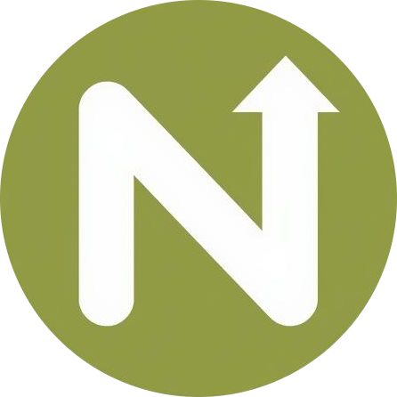

<p align="center">
  
</p>

# Noonlaunch MCP server

Launch your product on [Noonlaunch](https://noonlaunch.com) without leaving your editor, and let your agent browse the Noonlaunch directory, the weekly launch winners and a curated list of 333 places to launch a startup.

Noonlaunch is a product launch platform and directory. Makers launch products, the community votes, and the top 3 each week win a badge and a dofollow backlink.

- **Endpoint:** `https://noonlaunch.com/mcp`
- **Transport:** Streamable HTTP
- **Auth:** none. No API key and no account needed to connect.
- **Registry name:** `com.noonlaunch/mcp`
- **Docs:** https://noonlaunch.com/launch-with-ai

This repository holds the public listing files for the hosted server (`server.json`, logo and setup docs). The server itself runs at noonlaunch.com.

## Tools

| Tool | What it does | Kind |
|---|---|---|
| `search-directory` | Search the product directory, ordered by community votes | Read |
| `get-product` | Full public details of one product by its slug | Read |
| `get-weekly-winners` | A week's launch board, with the top 3 marked as winners | Read |
| `list-launch-directories` | 333 startup launch directories, filterable by category, cost and domain authority | Read |
| `get-plans` | What launching costs and what each plan includes | Read |
| `check-product` | Whether a site can be submitted, plus its plans, categories and launch weeks | Read |
| `submit-product` | Submit a product. Nothing is published until the maker opens a private claim link | Write |
| `verify-badge` | Check the Noonlaunch badge is live on the site and publish a free launch | Write |
| `check-status` | Where a submission stands: claimed, paid, verified, published | Read |
| `report-badge-problem` | Ask a person to review a badge check that keeps failing | Write |

Every tool carries `readOnlyHint`, `destructiveHint`, `idempotentHint` and `openWorldHint` annotations. No tool deletes anything.

## How submitting works

1. Your agent asks for your live website URL (never localhost) and calls `check-product`.
2. It drafts the name, tagline and description, shows them to you, and asks which plan you want.
3. `submit-product` returns a private, single-use claim link. You open it and sign in with Google to confirm the listing. Nothing goes public before that.
4. Free launches: the agent adds the badge to your footer, you deploy, and `verify-badge` publishes the listing. Paid launches are published by the payment provider, and the agent can only report what `check-status` says.

## Connect

### Claude Code

```bash
claude mcp add --transport http noonlaunch https://noonlaunch.com/mcp
```

### Claude (claude.ai and Claude Desktop)

Settings, Connectors, Add custom connector, then paste `https://noonlaunch.com/mcp`.

### Cursor

`~/.cursor/mcp.json`:

```json
{
  "mcpServers": {
    "noonlaunch": {
      "url": "https://noonlaunch.com/mcp"
    }
  }
}
```

### VS Code

`.vscode/mcp.json`:

```json
{
  "servers": {
    "noonlaunch": {
      "type": "http",
      "url": "https://noonlaunch.com/mcp"
    }
  }
}
```

### Codex

```bash
codex mcp add noonlaunch --url https://noonlaunch.com/mcp
```

### Any other client

Point it at `https://noonlaunch.com/mcp` over Streamable HTTP. For clients that only speak stdio:

```bash
npx -y mcp-remote https://noonlaunch.com/mcp
```

## Example prompts

- "Launch this project on Noonlaunch."
- "Who won on Noonlaunch last week?"
- "Find free launch directories with a domain authority above 50."
- "How much does it cost to launch on Noonlaunch?"

## Limits

60 requests per minute per client.

## Privacy and terms

- Privacy policy: https://noonlaunch.com/privacy-policy
- Terms: https://noonlaunch.com/terms

## Support

Open an issue on this repository, or email support@noonlaunch.com.

## License

The files in this repository are MIT licensed. See [LICENSE](LICENSE).
